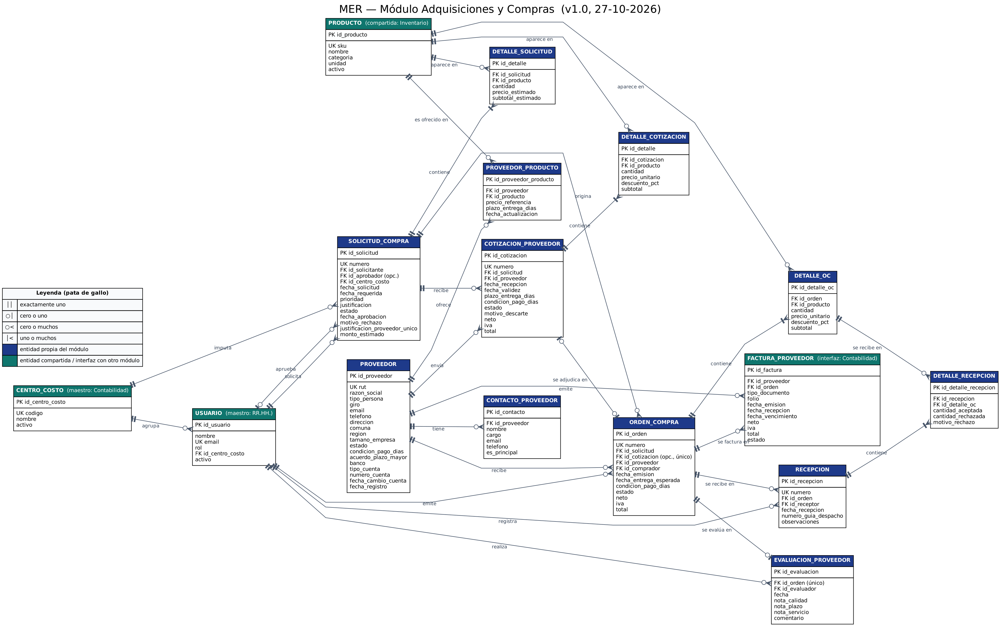

# Módulo Adquisiciones y Compras — MVP de ERP

Trabajo grupal de **Modelación de Sistemas 2026-2**, Departamento de Ingeniería Industrial, Universidad de Concepción.

**Integrantes**: Bastián Domke Cifuentes, Joaquín Westermeier Manoli, Julio Castro González, Valentina Barrientos Acuña, Maximiliano Cid Cereceda, Franco García Lépez.

## Estado del repositorio

**Especificación lista para pasar a tareas.** Están el modelo de datos, las historias de usuario y el plan técnico del módulo. La implementación se hará sobre el template del curso (descrito al final de este archivo) con Spec Driven Development (Speckit), en iteraciones semanales definidas en el [plan técnico](specs/002-modulo-adquisiciones-compras/plan.md).

## Problema y solución (resumen)

En muchas pymes las compras se gestionan por correo y planillas: no queda registro de quién autorizó cada compra, se paga lo que el proveedor factura aunque no coincida con lo recibido, y las facturas se aprueban tarde, incumpliendo el plazo legal de pago de 30 días.

El MVP propone un módulo de Adquisiciones y Compras integrado al ERP que ordena el ciclo completo:

```
Solicitud de compra → Cotizaciones de proveedores → Orden de compra → Recepción → Factura del proveedor
```

## Documentación del módulo

| Documento | Contenido |
|---|---|
| [`spec.md`](specs/002-modulo-adquisiciones-compras/spec.md) | Problema, solución, usuarios, 10 historias de usuario, requisitos y criterios de éxito |
| [`plan.md`](specs/002-modulo-adquisiciones-compras/plan.md) | Cómo se construye sobre el template, iteraciones semanales, pruebas y escalabilidad |
| [`data-model.md`](specs/002-modulo-adquisiciones-compras/data-model.md) | MER, diccionario de datos, reglas de negocio, datos sensibles, riesgos y sesgos |
| [`plan-de-trabajo.md`](docs/plan-de-trabajo.md) | Cronograma, roles del grupo y correspondencia con la rúbrica |
| [`feedback.md`](feedback.md) | Feedback del profesor a la revisión intermedia |

## Modelo entidad-relación



La imagen se genera desde el diagrama de `data-model.md`, así siempre coinciden. Para regenerarla se requiere Python y [Graphviz](https://graphviz.org/download/). Desde la raíz del repositorio:

```bash
python docs/generar_mer.py
dot -Tpng -Gdpi=150 docs/mer.dot -o docs/mer.png
```

## Archivos del módulo

```
docs/
├── plan-de-trabajo.md
├── mer.png                         ← imagen del MER
├── mer.dot                         ← fuente de la imagen (generada)
└── generar_mer.py                  ← genera mer.dot desde data-model.md
specs/
├── 001-erp-base-module/            ← especificación del template (no se modifica)
└── 002-modulo-adquisiciones-compras/
    ├── spec.md
    ├── plan.md
    └── data-model.md
```

## Registro de decisiones

Las decisiones de diseño se registran como **Issues** con la etiqueta `decision`.

---

## Template base del curso: ERP Software Base Module (Vite + Vanilla JS)

Minimal single-page app serving as an Enterprise Resource Planning (ERP) software base module. It provides the common foundation for building custom ERP modules: master data management (Entities) and linked transactional documents (Documents) with create/edit/delete/search, validation, and browser localStorage persistence — using Vite and vanilla HTML, CSS, and JavaScript.

The user interface is fully in **Spanish** (default terms: Entidad / Documento; module name: Módulo Base ERP), including labels, validation messages, empty states, and dialogs.

Entities carry standard ERP master-data fields (name, code, tax ID, email, phone, address, category, target date, credit limit, payment terms). Documents use series + folio numbering and carry a monetary breakdown (subtotal, discount, tax, total), currency, payment terms, notes, quantity, dates, and status.

The app presents itself as a coherent ERP workspace:

- **Workspace shell** — every screen lives inside a branded chrome: a top bar with a logo (an SVG monogram derived from the module name) and module name, plus a persistent sidebar of module buttons (Panel, Entidades, Documentos, Búsqueda). The active module is highlighted (`aria-current="page"`), and the sidebar collapses to an icon rail on narrow viewports.
- **Home dashboard** — the entry screen offers quick-action buttons for key ERP tasks (new entity, new document, open management areas, find records) and live statistic cards showing record counts.
- **Design tokens** — styling is driven by CSS custom properties in `src/styles.css`, so branding changes apply globally.

### Setup

Install dependencies and run the dev server:

```bash
npm install
npm run dev
```

Open http://localhost:5173 (or the URL Vite prints).

### Tests

Run the full test suite (unit + integration) with:

```bash
npm test
```

Or a one-off run without watch mode:

```bash
npx vitest run
```

### Building Custom Modules

Custom ERP modules built on this base define:

- What an **Entity** represents (e.g., customer, product, asset) plus domain-specific fields.
- What a **Document** represents (e.g., order, invoice, contract).
- Module-specific labels and validation rules.

The base module handles identity generation, timestamps, referential integrity between entities and documents, cascade deletion, navigation, and search. See `specs/001-erp-base-module/` for the full specification.

### Tailoring via Configuration

All tailoring lives in one place: the `userConfig` object at the top of `src/module-config.js`. Developers edit this single export; no core code changes are required. Available knobs:

- `moduleName` — display name shown in the top bar, dashboard, and document title; also derives the logo monogram.
- `labels` — rename Entity/Document terms across every screen, including sidebar buttons, quick actions, forms, and messages. Spanish articles and agreements (el/la, seleccionado/a) are derived from the first word of each configured term.
- `customFields` — declare extra fields per record type with `target` (`entity` or `document`), `key`, `label`, `type` (`text`, `number`, `date`, or `select`), optional `required`, and `options` for selects. Keys must not collide with base field names (see `specs/001-erp-base-module/data-model.md`). Values persist alongside records and appear in search results.
- `statusLifecycle` — restrict document statuses to a configured list of `statuses` with permitted `transitions` between them. Without it, status stays a free-form field.
- `theme.accentColor` — a hex color (e.g., `"#0f62fe"`) applied across the shell as highlights and primary controls. Invalid values fall back to the default.

If the configuration is invalid (unknown types, bad keys, transitions referencing unknown statuses, non-hex accent colors), the app shows the problems in a banner and falls back to defaults instead of breaking.

### Notes

- Data is persisted to `localStorage` under the keys `erp_base_module:entities` and `erp_base_module:documents`.
- Deleting an entity also deletes its documents (cascade).
- This project intentionally uses vanilla HTML, CSS, and JavaScript for simplicity.
