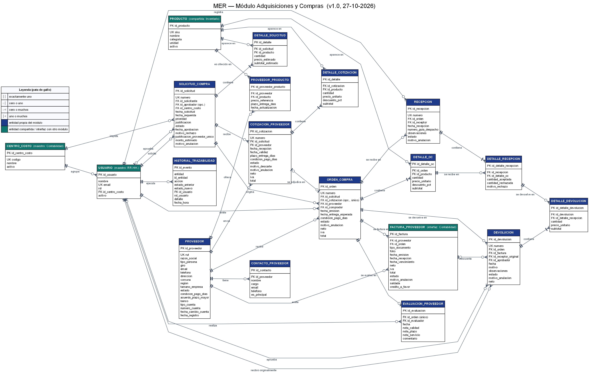

# Módulo Adquisiciones y Compras — MVP de ERP

Trabajo grupal de **Modelación de Sistemas 2026-2**, Departamento de Ingeniería Industrial, Universidad de Concepción.

**Integrantes**: Bastián Domke Cifuentes, Joaquín Westermeier Manoli, Julio Castro González, Valentina Barrientos Acuña, Maximiliano Cid Cereceda, Franco García Lépez.

## Estado del Repositorio

**MVP funcional y probado en su núcleo, con tareas de cierre pendientes.** La aplicación ya no expone el template base en la interfaz: `index.html` contiene una única navegación (**Compras**) y un selector **Rol Activo** en la barra superior. El acceso se realiza eligiendo un rol y usando la clave genérica de demostración **`Compras2026`** (no protege datos reales; los roles siguen siendo simulados). Solo **Solicitante** y **Comprador** piden nombre; Jefatura, Bodega y Admin TI ingresan únicamente con su rol. El módulo cubre US1 a US11: el ciclo solicitud → cotización → orden de compra → recepción → factura → devolución, además del panel por rol, catálogo, evaluaciones y exportación CSV.

El código de soporte del template base (`src/storage.js`, `src/module-config.js` y `src/components/`) se conserva como dependencia técnica, pero sus vistas (Panel, Entidades, Documentos y Búsqueda) ya no forman parte de la interfaz. Las pruebas de integración heredadas se mantienen en el repositorio con `describe.skip` y una nota que explica el motivo. El nombre por defecto de la aplicación es **Adquisiciones y Compras**.

La implementación se construyó sobre la plantilla base utilizando la metodología *Spec-Driven Development* (Speckit), siguiendo el [Plan Técnico](specs/002-modulo-adquisiciones-compras/plan.md) y la lista de [Tareas del Módulo](specs/002-modulo-adquisiciones-compras/tasks.md).

### Ejecución rápida

```bash
npm install
npm run dev           # servidor de desarrollo Vite (http://localhost:5173)
npm test              # pruebas en modo observación
npx vitest run        # suite completa una vez
npm run lint          # ESLint
npm run format:check  # Prettier (modo verificación)
npm run build         # build de producción
npm run preview       # vista previa del build (http://localhost:4173)
```

### Interfaz actual

- **Acceso**: pantalla de ingreso con selector de rol, campo de nombre condicional (solo Solicitante y Comprador), clave genérica `Compras2026`, opción para mostrar/ocultar la clave y cierre de sesión desde la barra superior. Los demás roles no tienen nombre: la sesión muestra únicamente su rol.
- **Barra superior**: marca *Adquisiciones y Compras* con logotipo monograma SVG, selector **Rol Activo** y botón **Cerrar sesión**. Al cambiar el rol se recalculan los permisos y el contenido del panel en vivo, sin recargar la página.
- **Barra lateral**: una sola sección, **Compras**, marcada como página activa (`aria-current="page"`) y con nombre accesible también cuando el icono se colapsa.
- **Pestañas del módulo**: Panel, Proveedores, Solicitudes, Cotizaciones, Órdenes de compra, Recepciones, Facturas, Devoluciones, Catálogo y Evaluaciones. La exportación CSV está disponible desde el módulo.
- **Panel**: pendientes por rol con contador y acceso directo, alertas de facturas por vencer, seguimiento de OC sin recepción, indicadores del mes y acciones rápidas.

### Roles y datos semilla

La sesión inicial corresponde al rol `solicitante`. El selector **Rol Activo** permite probar en vivo los cinco roles definidos en la especificación:

| Rol | Permisos principales |
|---|---|
| `solicitante` | Crear y ver sus solicitudes; exportar. |
| `comprador` | Gestionar proveedores, cotizaciones, OC, facturas, catálogo y evaluaciones; emitir OC y registrar facturas. |
| `jefe_compras` | Aprobar solicitudes, pagos y devoluciones; ver datos sensibles sin enmascarar (la edición bancaria sigue siendo exclusiva de `admin_ti`). |
| `bodega` | Registrar recepciones y devoluciones. |
| `admin_ti` | Acceso completo, incluida la edición de datos bancarios de proveedores. |

El RUT de personas naturales y el número de cuenta bancaria se enmascaran según el rol; solo `admin_ti` puede editar la cuenta y al hacerlo se actualiza `fecha_cambio_cuenta`. La regla está centralizada en `COMPRAS_PARAMETROS.datosBancarios` (`src/module-config.js`) y la consumen `src/compras/reglas.js`, `src/compras/proveedores.js` y la vista de Proveedores, de modo que al cambiar el rol en la barra superior la tabla se actualiza de inmediato.

La primera visita carga automáticamente `src/compras/semilla.json` con datos ficticios: 6 usuarios, 4 centros de costo, 20 productos, 8 proveedores, 10 solicitudes, 7 cotizaciones, 8 órdenes de compra, 5 recepciones, 7 documentos de facturación (incluidas notas de crédito), 2 devoluciones, 10 referencias de catálogo y 2 evaluaciones. Las fechas se desplazan al día actual para mantener vigentes los vencimientos y plazos.

Las colecciones del módulo se guardan en `localStorage` con el prefijo `erp_compras:`; los proveedores se comparten con la entidad base (`erp_base_module:entities`). Para reiniciar los datos, limpia las claves `erp_compras:*` y `erp_base_module:entities` del almacenamiento local o ejecuta `await import('/src/compras/almacenamiento.js').then((m) => m.reiniciarCompras())` desde la consola con Vite abierto; después recarga la página.

### Verificación y Pendientes

Estado al cierre de esta iteración:

- `npx vitest run`: **145 pruebas aprobadas** y 56 omitidas (corresponden a las pruebas heredadas del template base).
- `npm run lint`: **0 errores**.
- `npm run format:check`: **sin diferencias**.
- `npm run build`: **build de producción sin errores**.

Tareas registradas como pendientes en [`tasks.md`](specs/002-modulo-adquisiciones-compras/tasks.md):

- **US5**: T043-T050 (verificación integrada del panel y sus seis escenarios; la limpieza de la interfaz T111 y los datos simulados T112 ya están completados).
- **US11**: T100, T101 y T110 (daño detectado después de la aceptación, cierre de OC con saldo pendiente y crédito a favor).
- **Trazabilidad**: T102-T106, T109 y T118 (registro de auditoría, cadena documental, anulaciones y pruebas de punta a punta).
- **Modelo de datos**: T101 y T118 (pendientes 2 y 3 de `data-model.md` §10); T117 y T119 están cerradas.
- **Calidad**: T107 y T108 están cerradas: lint y formato sin diferencias, y accesibilidad WCAG 2.1 AA revisada (etiquetas asociadas, navegación por teclado en pestañas, errores en banner `role="alert"`, contraste mínimo 4,5:1 y respeto a `prefers-reduced-motion`).

## Problema y solución (Resumen)

En muchas pymes las compras se gestionan por correo y planillas: no queda registro de quién autorizó cada compra, se paga lo que el proveedor factura aunque no coincida con lo recibido, y las facturas se aprueban tarde, incumpliendo el plazo legal de pago de 30 días.

El MVP propone un módulo de Adquisiciones y Compras integrado al ERP que ordena el ciclo completo:

```
Solicitud de compra → Cotizaciones de proveedores → Orden de compra → Recepción → Factura del proveedor
```

## Documentación del módulo

| Documento | Contenido |
|---|---|
| [`spec.md`](specs/002-modulo-adquisiciones-compras/spec.md) | Problema, solución, usuarios, 11 historias de usuario, requisitos y criterios de éxito |
| [`plan.md`](specs/002-modulo-adquisiciones-compras/plan.md) | Cómo se construye sobre la plantilla base, iteraciones semanales, pruebas y escalabilidad |
| [`research.md`](specs/002-modulo-adquisiciones-compras/research.md) | Decisiones técnicas de la Fase 0, justificaciones y alternativas consideradas |
| [`data-model.md`](specs/002-modulo-adquisiciones-compras/data-model.md) | Modelo Entidad-Relación (MER), diagrama de clases, atributos y reglas de negocio |
| [`quickstart.md`](specs/002-modulo-adquisiciones-compras/quickstart.md) | Guion de ejecución y validación de extremo a extremo con datos semilla |
| [`contracts/`](specs/002-modulo-adquisiciones-compras/contracts/) | Contratos de almacenamiento, exportación CSV, permisos e integración con otros módulos |
| [`tasks.md`](specs/002-modulo-adquisiciones-compras/tasks.md) | Plan de ejecución y desglose técnico ordenado por fases e historias de usuario |
| [`plan-de-trabajo.md`](docs/plan-de-trabajo.md) | Cronograma, roles del equipo y correspondencia con la rúbrica de evaluación |
| [`feedback.md`](feedback.md) | Retroalimentación del profesor y ajustes aplicados tras la revisión intermedia |

## Modelo entidad-relación



La imagen se genera desde el diagrama de `data-model.md`, así siempre coinciden. Para regenerarla se requiere Python y [Graphviz](https://graphviz.org/download/). Desde la raíz del repositorio:

```bash
python docs/generar_mer.py
dot -Tpng -Gdpi=150 docs/mer.dot -o docs/mer.png
```

## Estructura del repositorio

```text
docs/
├── plan-de-trabajo.md
├── mer.png                         ← Imagen del Modelo Entidad-Relación (MER)
├── mer.dot                         ← Fuente del diagrama (generada)
└── generar_mer.py                  ← Genera mer.dot desde data-model.md
specs/
├── 001-erp-base-module/            ← Especificación del template base (no se modifica)
└── 002-modulo-adquisiciones-compras/
        ├── spec.md
        ├── plan.md
        ├── research.md
        ├── data-model.md
        ├── quickstart.md
        ├── contracts/
        │       ├── almacenamiento-compras.md
        │       └── exportacion-e-integracion.md
        ├── tasks.md
        └── checklists/
                └── requirements.md
src/
├── app.js                          ← Arranque, acceso simulado y selector de Rol Activo
├── main.js                         ← Punto de entrada Vite
├── module-config.js                ← Configuración heredada del template base
├── storage.js                      ← Persistencia heredada del template base
├── components/                     ← Componentes heredados del template base
└── compras/                        ← Módulo US1-US11
        ├── vista.js                ← Navegación, pestañas y renderizado
        ├── almacenamiento.js       ← Sesión, permisos y persistencia del módulo
        ├── autenticacion.js        ← Acceso simulado con clave genérica de demostración
        ├── semilla.json            ← Datos ficticios de demostración
        └── reglas.js, proveedores.js, solicitudes.js, cotizaciones.js,
            ordenes-compra.js, recepciones.js, facturas.js, devoluciones.js,
            panel.js, evaluaciones.js, trazabilidad.js, exportacion.js
tests/
├── integration/                    ← Pruebas de integración (las del template base están omitidas)
└── unit/                           ← Pruebas unitarias
```

## Registro de decisiones

Las decisiones de diseño se registran como *Issues* con la etiqueta `decision`.

---

## Origen: Template base del curso (Módulo Base ERP, Vite + Vanilla JS)

El proyecto se originó a partir de una aplicación de página única (*single-page app*) con gestión de entidades y documentos, persistencia en `localStorage` y una configuración centralizada. Esa base aportó los tokens de diseño en `src/styles.css`, el logotipo monograma, el manejo de errores de configuración y parte de la persistencia.

En la plantilla original, el espacio de trabajo mostraba Panel, Entidades, Documentos y Búsqueda; esas vistas se retiraron de `index.html` al incorporar el módulo de Adquisiciones y Compras. El código de apoyo permanece disponible, pero la personalización mediante `userConfig` ya no altera las etiquetas de la interfaz del módulo: solo se usa el nombre de la aplicación y el color de acento.

### Configuración

El objeto `userConfig` de `src/module-config.js` mantiene las opciones heredadas:

- `moduleName` — Nombre de la aplicación, título de la página y origen del monograma. Por defecto: `Adquisiciones y Compras`.
- `labels` — Terminología Entidad/Documento del template base; no afecta las pestañas del módulo.
- `customFields` — Campos adicionales del template base (`text`, `number`, `date` o `select`).
- `statusLifecycle` — Transiciones configurables de estados del template base.
- `theme.accentColor` — Color hexadecimal aplicado a la marca y los controles principales.

Si la configuración es inválida, la aplicación muestra los problemas en el banner `#config-errors` y utiliza los valores por defecto sin fallar.

### Notas heredadas

- Las entidades y documentos del template base se persisten en `localStorage` bajo `erp_base_module:entities` y `erp_base_module:documents`.
- Al eliminar una entidad del template base, también se eliminan sus documentos asociados (*eliminación en cascada*).
- El proyecto utiliza intencionalmente HTML, CSS y JavaScript puros, sin frameworks de interfaz.
