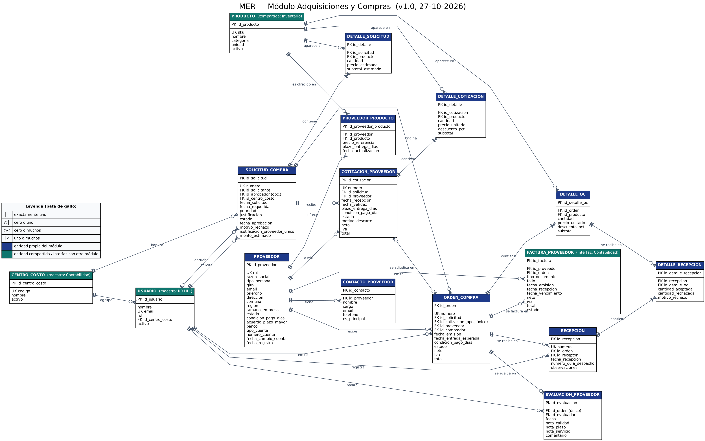

# Módulo Adquisiciones y Compras — MVP de ERP

Trabajo grupal de **Modelación de Sistemas 2026-2**, Departamento de Ingeniería Industrial, Universidad de Concepción.

**Integrantes**: Bastián Domke Cifuentes, Joaquín Westermeier Manoli, Julio Castro González, Valentina Barrientos Acuña, Maximiliano Cid Cereceda, Franco García Lépez.

## Estado del Repositorio

**MVP implementado y probado.** El módulo de Adquisiciones y Compras se integra en la navegación principal junto al template base y cubre el ciclo solicitud → cotización → orden de compra → recepción → factura → devolución, además del panel por rol, catálogo, evaluaciones y exportación CSV.

La implementación se construyó sobre la plantilla base utilizando la metodología *Spec-Driven Development* (Speckit), siguiendo el [Plan Técnico](specs/002-modulo-adquisiciones-compras/plan.md) y la lista de [Tareas del Módulo](specs/002-modulo-adquisiciones-compras/tasks.md).

### Ejecución rápida

```bash
npm install
npm run dev        # servidor de desarrollo Vite
npm test           # pruebas en modo observación
npx vitest run     # suite completa una vez
npm run lint       # ESLint
npm run build      # build de producción
```

### Roles y datos semilla

La sesión de compras parte con el rol `solicitante` y puede cambiarse desde el selector de la esquina superior derecha del módulo. Roles disponibles: `solicitante`, `comprador`, `jefe_compras`, `bodega` y `admin_ti`.

La primera visita carga automáticamente `src/compras/semilla.json` con datos ficticios: 6 usuarios, 4 centros de costo, 20 productos, 8 proveedores, 10 solicitudes, 7 cotizaciones, 8 órdenes de compra, 5 recepciones, 7 documentos de facturación (incluidas notas de crédito), 2 devoluciones, 10 referencias de catálogo y 2 evaluaciones. Las fechas se desplazan al día actual para mantener vigentes los vencimientos y plazos.

Las colecciones del módulo se guardan en `localStorage` con el prefijo `erp_compras:`; los proveedores se comparten con la entidad base (`erp_base_module:entities`). Para reiniciar los datos, limpia el almacenamiento local del navegador o ejecuta `reiniciarCompras()` desde la consola.


## Problema y solución (Resumen)

En muchas pymes las compras se gestionan por correo y planillas: no queda registro de quién autorizó cada compra, se paga lo que el proveedor factura aunque no coincida con lo recibido, y las facturas se aprueban tarde, incumpliendo el plazo legal de pago de 30 días.

El MVP propone un módulo de Adquisiciones y Compras integrado al ERP que ordena el ciclo completo:

```
Solicitud de compra → Cotizaciones de proveedores → Orden de compra → Recepción → Factura del proveedor
```

## Documentación del módulo

| Documento | Contenido |
|---|---|
| [`spec.md`](specs/002-modulo-adquisiciones-compras/spec.md) | Problema, solución, usuarios, 11 historias de usuario, requisitos y criterios de éxito |
| [`plan.md`](specs/002-modulo-adquisiciones-compras/plan.md) | Cómo se construye sobre la plantilla base, iteraciones semanales, pruebas y escalabilidad |
| [`data-model.md`](specs/002-modulo-adquisiciones-compras/data-model.md) | Modelo Entidad-Relación (MER), diagrama de clases, atributos y reglas de negocio |
| [`tasks.md`](specs/002-modulo-adquisiciones-compras/tasks.md) | Plan de ejecución y desglose técnico ordenado por fases e historias de usuario |
| [`plan-de-trabajo.md`](docs/plan-de-trabajo.md) | Cronograma, roles del equipo y correspondencia con la rúbrica de evaluación |
| [`feedback.md`](feedback.md) | Retroalimentación del profesor y ajustes aplicados tras la revisión intermedia |

## Modelo entidad-relación



La imagen se genera desde el diagrama de `data-model.md`, así siempre coinciden. Para regenerarla se requiere Python y [Graphviz](https://graphviz.org/download/). Desde la raíz del repositorio:

```bash
python docs/generar_mer.py
dot -Tpng -Gdpi=150 docs/mer.dot -o docs/mer.png
```

## Archivos del módulo

```
docs/
├── plan-de-trabajo.md
├── mer.png                         ← Imagen del Modelo Entidad-Relación (MER)
├── mer.dot                         ← Fuente del diagrama (generada)
└── generar_mer.py                  ← Genera mer.dot desde data-model.md
specs/
├── 001-erp-base-module/            ← Especificación del template base (no se modifica)
└── 002-modulo-adquisiciones-compras/
│       ├── spec.md
│       ├── plan.md
│       ├── data-model.md
│       └── tasks.md
tests/
├── integration/                   ← Casos de prueba de integración
└── unit/                          ← Casos de prueba unitarios
```

## Registro de decisiones

Las decisiones de diseño se registran como *Issues* con la etiqueta `decision`.

---

## Template base del curso: Módulo Base ERP (Vite + Vanilla JS)

Aplicación de página única (*single-page app*) que sirve como base para construir módulos ERP personalizados. Proporciona los fundamentos comunes: gestión de datos maestros (*Entidades*) y documentos transaccionales asociados (*Documentos*), con funcionalidades de crear, editar, eliminar, buscar, validación y persistencia en `localStorage` del navegador, utilizando Vite, HTML, CSS y JavaScript puros.

La interfaz de usuario está completamente en **español** (términos por defecto: Entidad / Documento; nombre del módulo: Módulo Base ERP), incluyendo etiquetas, mensajes de validación, estados vacíos y diálogos.

Las entidades cuentan con campos maestros estándar de ERP (nombre, código, RUT/identificación tributaria, correo electrónico, teléfono, dirección, categoría, fecha objetivo, límite de crédito, condiciones de pago). Los documentos utilizan numeración por serie y folio, y contienen un desglose monetario (subtotal, descuento, impuesto, total), moneda, condiciones de pago, notas, cantidades, fechas y estado.

La aplicación presenta un espacio de trabajo ERP coherente:

- **Marco de trabajo (*workspace shell*)** — Todas las pantallas se encuentran dentro de un marco con marca: barra superior con logotipo (monograma SVG derivado del nombre del módulo) y nombre del módulo, junto a una barra lateral persistente con los módulos (Panel, Compras, Entidades, Documentos, Búsqueda). El módulo activo se resalta (`aria-current="page"`) y la barra lateral se colapsa a un menú de iconos en pantallas pequeñas.
- **Panel de inicio (*dashboard*)** — Pantalla de entrada con botones de acción rápida para las tareas clave (nueva entidad, nuevo documento, abrir gestión, buscar registros) y tarjetas con estadísticas en tiempo real del número de registros.
- **Tokens de diseño** — Los estilos se basan en variables CSS definidas en `src/styles.css`, lo que permite aplicar cambios de marca de forma global.

### Configuración e inicio

Instalar dependencias y ejecutar el servidor de desarrollo:

```bash
npm install
npm run dev
```

Abrir [http://localhost:5173](http://localhost:5173) o la URL que indique Vite.

### Pruebas

Ejecutar todo el conjunto de pruebas (unitarias e integración) en modo observación:

```bash
npm test
```

O ejecutar una sola vez sin modo observación:

```bash
npx vitest run
```

### Construcción de módulos personalizados

Los módulos ERP personalizados construidos sobre esta base deben definir:

- Qué representa una **Entidad** (ej.: cliente, producto, activo), junto con sus campos específicos del dominio.
- Qué representa un **Documento** (ej.: orden de compra, factura, contrato).
- Las etiquetas y reglas de validación propias del módulo.

El módulo base se encarga de la generación de identificadores, marcas de tiempo, integridad referencial entre entidades y documentos, eliminación en cascada, navegación y búsqueda. Ver `specs/001-erp-base-module/` para la especificación completa.

### Personalización mediante configuración

Toda la personalización se realiza desde un único lugar: el objeto `userConfig` en la parte superior de `src/module-config.js`. No es necesario modificar el código base. Las opciones disponibles son:

- `moduleName` — Nombre del módulo mostrado en la barra superior, panel de inicio y título de la página. También se utiliza para generar el logotipo.
- `labels` — Permite renombrar los términos Entidad/Documento en todas las pantallas (barra lateral, acciones rápidas, formularios, mensajes, etc.). Los artículos y concordancias en español (el/la, seleccionado/a) se derivan automáticamente a partir del primer término configurado.
- `customFields` — Permite agregar campos adicionales por tipo de registro (`entity` o `document`) con `key`, `label`, `type` (`text`, `number`, `date` o `select`), `required` opcional y `options` para listas desplegables. Las claves no deben colisionar con los campos base (ver `specs/001-erp-base-module/data-model.md`). Los valores se guardan junto al registro y aparecen en los resultados de búsqueda.
- `statusLifecycle` — Restringe los estados de los documentos a una lista configurada con transiciones permitidas. Si no se configura, el estado permanece como campo libre.
- `theme.accentColor` — Color hexadecimal (ej.: `"#0f62fe"`) aplicado al marco y a los controles principales. Si es inválido o no se especifica, se utiliza el valor por defecto.

Si la configuración es inválida (tipos desconocidos, claves en conflicto, transiciones a estados inexistentes o colores no hexadecimales), la aplicación mostrará los problemas en un banner y utilizará los valores por defecto sin fallar.

### Notas

- Los datos se persisten en `localStorage` bajo las claves `erp_base_module:entities` y `erp_base_module:documents`.
- Al eliminar una entidad, también se eliminan sus documentos asociados (*eliminación en cascada*).
- Este proyecto utiliza intencionalmente HTML, CSS y JavaScript puros por simplicidad.
