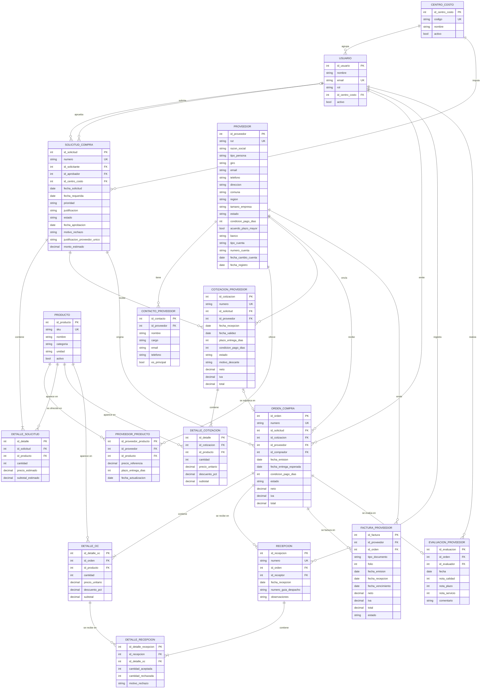

# Data Model: Módulo Adquisiciones y Compras

**Feature**: `002-modulo-adquisiciones-compras` (el `001` corresponde al módulo base del template del curso)
**Estado**: Borrador v1.0 (27 de octubre de 2026). Reemplaza el borrador del módulo Ventas  / CRM; ver sección 9.
**Alcance**: Solo frontend, sobre el template del curso. Los datos se persisten como datos semilla (JSON) y en `localStorage` del navegador. No hay backend.

---

## 1. Propósito del modelo

El módulo cubre las dos caras del abastecimiento de una pyme:

- **Adquisiciones** (nivel estratégico): qué proveedores existen, qué ofrecen, a qué precio de referencia y qué tan bien cumplen.
- **Compras** (nivel operativo): el ciclo que transforma una necesidad interna en un bien recibido y una factura lista para pagar.

```
Solicitud de compra → Cotizaciones de proveedores → Orden de compra → Recepción → Factura del proveedor
```

El modelo está pensado para responder cuatro preguntas de negocio:

1. ¿Qué se está pidiendo, quién lo pide, para qué centro de costo y en qué etapa está cada solicitud?
2. ¿A qué proveedor conviene comprar, considerando precio, plazo y desempeño histórico?
3. ¿Se recibió lo que se compró, en la cantidad y fecha comprometidas?
4. ¿La factura coincide con lo pedido y lo recibido, y se aprobará a tiempo para pagarla dentro del plazo legal?

---

## 2. Diagrama entidad-relación

GitHub renderiza este diagrama directamente. La versión en imagen está en [`docs/mer.png`](../../docs/mer.png) y se genera desde [`docs/mer.dot`](../../docs/mer.dot).




---

## 3. Diccionario de datos

Convenciones: **PK** = clave primaria, **FK** = clave foránea, **UK** = valor único, **(S)** = dato personal o sensible (ver sección 6). Montos en pesos chilenos (CLP), enteros, sin decimales.

### 3.1 CENTRO_COSTO
Área de la empresa a la que se imputa una compra (p. ej., Administración, Producción, Ventas).

| Atributo | Tipo | Restricción | Descripción |
|---|---|---|---|
| id_centro_costo | int | PK | |
| codigo | string | UK, obligatorio | Ej.: `CC-ADM` |
| nombre | string | obligatorio | |
| activo | bool | default `true` | Un centro inactivo no puede recibir solicitudes nuevas |

### 3.2 USUARIO
Persona interna que opera el módulo. Su ficha maestra pertenece a RR.HH.

| Atributo | Tipo | Restricción | Descripción |
|---|---|---|---|
| id_usuario | int | PK | |
| nombre | string | obligatorio | (S) |
| email | string | UK, obligatorio | Correo corporativo |
| rol | enum | `solicitante`, `comprador`, `jefe_compras`, `bodega`, `admin` | Define qué acciones puede hacer (ver regla 8, segregación de funciones) |
| id_centro_costo | int | FK → CENTRO_COSTO | Área a la que pertenece |
| activo | bool | default `true` | |

### 3.3 PROVEEDOR
Persona natural o empresa que vende bienes o servicios a la organización. Es el dato maestro central de **adquisiciones**.

| Atributo | Tipo | Restricción | Descripción |
|---|---|---|---|
| id_proveedor | int | PK | |
| rut | string | UK, formato `12345678-9`, dígito verificador válido | (S si es persona natural) |
| razon_social | string | obligatorio | (S si es persona natural) |
| tipo_persona | enum | `natural`, `juridica` | |
| giro | string | obligatorio | Giro comercial según SII |
| email, telefono | string | al menos uno obligatorio | Contacto general (S si es persona natural) |
| direccion, comuna, region | string | `region` obligatoria | |
| tamano_empresa | enum | `micro`, `pequena`, `mediana`, `grande` | Permite medir cuánto se compra a pymes (ver sesgos, sección 6) |
| estado | enum | `potencial`, `aprobado`, `bloqueado` | Solo un proveedor `aprobado` puede recibir órdenes de compra |
| condicion_pago_dias | int | default 30; > 30 solo si `acuerdo_plazo_mayor = true` | Plazo de pago acordado, contado desde la recepción de la factura |
| acuerdo_plazo_mayor | bool | default `false` | `true` solo si existe un acuerdo escrito de plazo mayor a 30 días inscrito según la Ley 21.131 |
| banco, tipo_cuenta, numero_cuenta | string | opcional | Datos para el pago (S). Se muestran enmascarados |
| fecha_cambio_cuenta | date | se actualiza al modificar datos bancarios | Permite alertar pagos a cuentas recién cambiadas (ver sección 6) |
| fecha_registro | date | obligatorio | |

### 3.4 CONTACTO_PROVEEDOR
Persona de contacto dentro de un proveedor.

| Atributo | Tipo | Restricción | Descripción |
|---|---|---|---|
| id_contacto | int | PK | |
| id_proveedor | int | FK → PROVEEDOR | |
| nombre, cargo | string | `nombre` obligatorio | (S) |
| email, telefono | string | al menos uno obligatorio | (S) |
| es_principal | bool | máximo uno `true` por proveedor | |

### 3.5 PRODUCTO
Bien o servicio que se compra. **Entidad compartida** con el módulo de Inventario: Compras solo la lee.

| Atributo | Tipo | Restricción | Descripción |
|---|---|---|---|
| id_producto | int | PK | |
| sku | string | UK | Código del producto |
| nombre, categoria | string | obligatorio | |
| unidad | string | obligatorio | `unidad`, `caja`, `kg`, `hora`, etc. |
| activo | bool | default `true` | Un producto inactivo no se puede solicitar |

### 3.6 PROVEEDOR_PRODUCTO
Catálogo de lo que ofrece cada proveedor, con su precio de referencia. Resuelve la relación N:M entre PROVEEDOR y PRODUCTO.

| Atributo | Tipo | Restricción | Descripción |
|---|---|---|---|
| id_proveedor_producto | int | PK | |
| id_proveedor | int | FK → PROVEEDOR | |
| id_producto | int | FK → PRODUCTO | |
| precio_referencia | decimal | > 0 | Precio neto conocido o negociado |
| plazo_entrega_dias | int | ≥ 0 | Plazo habitual de entrega |
| fecha_actualizacion | date | obligatorio | Un precio con más de 90 días sin actualizar se marca como desactualizado |

Restricción: la combinación (`id_proveedor`, `id_producto`) es única.

### 3.7 SOLICITUD_COMPRA y DETALLE_SOLICITUD
Necesidad interna formal. Es el punto de partida obligatorio de toda compra.

| Atributo | Tipo | Restricción | Descripción |
|---|---|---|---|
| id_solicitud | int | PK | |
| numero | string | UK, ej. `SC-2026-0001` | Correlativo visible |
| id_solicitante | int | FK → USUARIO | Quien pide |
| id_aprobador | int | FK → USUARIO, opcional | Se llena al aprobar o rechazar; debe ser distinto del solicitante |
| id_centro_costo | int | FK → CENTRO_COSTO | Por defecto, el del solicitante |
| fecha_solicitud | date | obligatorio | |
| fecha_requerida | date | ≥ fecha_solicitud | Cuándo se necesita |
| prioridad | enum | `normal`, `urgente` | |
| justificacion | text | obligatorio, máx. 500 caracteres | Para qué se necesita |
| estado | enum | `borrador`, `enviada`, `aprobada`, `rechazada`, `en_cotizacion`, `adjudicada`, `anulada` | Ver regla 2 |
| fecha_aprobacion | date | obligatorio si `aprobada` o `rechazada` | |
| motivo_rechazo | text | obligatorio si `rechazada` | |
| justificacion_proveedor_unico | text | opcional, máx. 500 caracteres | Permite seleccionar una cotización con menos de 3 ofertas sobre el umbral (regla 3) |
| monto_estimado | decimal | calculado | ∑ subtotal_estimado |

| Atributo (detalle) | Tipo | Restricción | Descripción |
|---|---|---|---|
| id_detalle | int | PK | |
| id_solicitud | int | FK → SOLICITUD_COMPRA | |
| id_producto | int | FK → PRODUCTO | |
| cantidad | int | > 0 | |
| precio_estimado | decimal | ≥ 0 | Se sugiere el menor `precio_referencia` del catálogo |
| subtotal_estimado | decimal | calculado | cantidad × precio_estimado |

### 3.8 COTIZACION_PROVEEDOR y DETALLE_COTIZACION
Oferta de un proveedor para una solicitud.

| Atributo | Tipo | Restricción | Descripción |
|---|---|---|---|
| id_cotizacion | int | PK | |
| numero | string | UK, ej. `CP-2026-0001` | Correlativo interno |
| id_solicitud | int | FK → SOLICITUD_COMPRA | |
| id_proveedor | int | FK → PROVEEDOR | Puede ser `potencial` o `aprobado`; no `bloqueado` |
| fecha_recepcion | date | obligatorio | |
| fecha_validez | date | ≥ fecha_recepcion | |
| plazo_entrega_dias | int | ≥ 0 | Plazo ofrecido |
| condicion_pago_dias | int | > 0 | Plazo de pago ofrecido |
| estado | enum | `recibida`, `seleccionada`, `descartada`, `vencida` | Ver regla 3 |
| motivo_descarte | enum | obligatorio si `descartada`: `precio`, `plazo`, `calidad`, `condiciones`, `otro` | Deja trazabilidad de por qué no se eligió |
| neto, iva, total | decimal | calculados | |

Restricción: la combinación (`id_solicitud`, `id_proveedor`) es única; si el proveedor reenvía su oferta, se actualiza la existente.

| Atributo (detalle) | Tipo | Restricción | Descripción |
|---|---|---|---|
| id_detalle | int | PK | |
| id_cotizacion | int | FK → COTIZACION_PROVEEDOR | |
| id_producto | int | FK → PRODUCTO | Debe estar en la solicitud |
| cantidad | int | > 0 | |
| precio_unitario | decimal | > 0 | Neto |
| descuento_pct | decimal | 0 a 100 | |
| subtotal | decimal | calculado | |

### 3.9 ORDEN_COMPRA y DETALLE_OC
Compromiso formal de compra con un proveedor.

| Atributo | Tipo | Restricción | Descripción |
|---|---|---|---|
| id_orden | int | PK | |
| numero | string | UK, ej. `OC-2026-0001` | |
| id_solicitud | int | FK → SOLICITUD_COMPRA, obligatorio | Toda OC nace de una solicitud aprobada |
| id_cotizacion | int | FK → COTIZACION_PROVEEDOR, opcional, **único** | Vacío en compras directas (regla 4). Una cotización genera como máximo una OC; como no hay backend, la unicidad la valida la aplicación |
| id_proveedor | int | FK → PROVEEDOR | Si hay cotización, debe ser el mismo proveedor de la cotización |
| id_comprador | int | FK → USUARIO | Rol `comprador` o `jefe_compras` |
| fecha_emision | date | obligatorio | |
| fecha_entrega_esperada | date | ≥ fecha_emision | |
| condicion_pago_dias | int | > 0 | Por defecto la del proveedor |
| estado | enum | `borrador`, `emitida`, `recibida_parcial`, `recibida_total`, `cerrada`, `anulada` | Ver regla 4 |
| neto, iva, total | decimal | calculados | |

| Atributo (detalle) | Tipo | Restricción | Descripción |
|---|---|---|---|
| id_detalle_oc | int | PK | Lo referencia la recepción |
| id_orden | int | FK → ORDEN_COMPRA | |
| id_producto | int | FK → PRODUCTO | |
| cantidad | int | > 0 | Cantidad comprometida |
| precio_unitario | decimal | > 0 | Se copia desde la cotización (o se ingresa en compra directa) y no cambia después |
| descuento_pct | decimal | 0 a 100 | |
| subtotal | decimal | calculado | |

### 3.10 RECEPCION y DETALLE_RECEPCION
Registro de lo que efectivamente llegó. Una OC puede recibirse en varias entregas.

| Atributo | Tipo | Restricción | Descripción |
|---|---|---|---|
| id_recepcion | int | PK | |
| numero | string | UK, ej. `RC-2026-0001` | |
| id_orden | int | FK → ORDEN_COMPRA | La OC debe estar `emitida` o `recibida_parcial` |
| id_receptor | int | FK → USUARIO | Rol `bodega`; distinto del comprador de la OC |
| fecha_recepcion | date | obligatorio | |
| numero_guia_despacho | string | opcional | Documento del proveedor que acompaña la entrega |
| observaciones | text | máx. 500 caracteres | |

| Atributo (detalle) | Tipo | Restricción | Descripción |
|---|---|---|---|
| id_detalle_recepcion | int | PK | |
| id_recepcion | int | FK → RECEPCION | |
| id_detalle_oc | int | FK → DETALLE_OC | Línea de la OC que se está recibiendo |
| cantidad_aceptada | int | ≥ 0 | Cuenta para completar la OC y para Inventario |
| cantidad_rechazada | int | ≥ 0 | aceptada + rechazada > 0 |
| motivo_rechazo | enum | obligatorio si rechazada > 0: `danado`, `no_corresponde`, `fuera_de_especificacion`, `otro` | |

### 3.11 FACTURA_PROVEEDOR
Factura o nota de crédito emitida por el proveedor por una OC. **Entidad de interfaz** con el módulo de Contabilidad, que registra la cuenta por pagar y el pago.

| Atributo | Tipo | Restricción | Descripción |
|---|---|---|---|
| id_factura | int | PK | |
| id_proveedor | int | FK → PROVEEDOR | Debe coincidir con el proveedor de la OC. Se guarda porque el folio es único por proveedor |
| id_orden | int | FK → ORDEN_COMPRA | La OC debe tener al menos una recepción |
| tipo_documento | enum | `factura`, `nota_credito` | |
| folio | int | > 0 | La combinación (`id_proveedor`, `tipo_documento`, `folio`) es única |
| fecha_emision | date | obligatorio | |
| fecha_recepcion | date | ≥ fecha_emision | Desde aquí se cuenta el plazo legal de pago |
| fecha_vencimiento | date | calculado | fecha_recepcion + condicion_pago_dias de la OC |
| neto, iva, total | decimal | obligatorios | Se ingresan tal como vienen en el documento |
| estado | enum | `recibida`, `conciliada`, `con_discrepancia`, `aprobada_pago`, `rechazada` | Ver regla 6 |

> En el MVP las facturas son **simuladas**: se ingresan a mano y no se conectan al SII.

### 3.12 EVALUACION_PROVEEDOR
Evaluación del desempeño del proveedor en una OC ya recibida.

| Atributo | Tipo | Restricción | Descripción |
|---|---|---|---|
| id_evaluacion | int | PK | |
| id_orden | int | FK → ORDEN_COMPRA, **único** | Una evaluación por OC; el proveedor se obtiene desde la OC |
| id_evaluador | int | FK → USUARIO | |
| fecha | date | obligatorio | |
| nota_calidad | int | 1 a 5 | Ingresada por el evaluador |
| nota_plazo | int | 1 a 5, **calculada** | Según días de atraso (regla 7); no la ingresa el usuario |
| nota_servicio | int | 1 a 5 | Ingresada por el evaluador |
| comentario | text | máx. 500 caracteres | |

---

## 4. Relaciones y cardinalidades

| Relación | Cardinalidad | Justificación |
|---|---|---|
| CENTRO_COSTO – USUARIO | 1 : N | Cada usuario pertenece a un área |
| CENTRO_COSTO – SOLICITUD_COMPRA | 1 : N | Toda compra se imputa a un centro de costo |
| USUARIO (solicitante) – SOLICITUD_COMPRA | 1 : N | |
| USUARIO (aprobador) – SOLICITUD_COMPRA | 0..1 : N | El aprobador se asigna recién al aprobar o rechazar |
| PROVEEDOR – CONTACTO_PROVEEDOR | 1 : N (0..N) | Un proveedor persona natural puede no tener contactos adicionales |
| PROVEEDOR – PRODUCTO | N : M | Resuelta por PROVEEDOR_PRODUCTO (catálogo con precio de referencia) |
| SOLICITUD_COMPRA – DETALLE_SOLICITUD | 1 : 1..N | Una solicitud sin productos no es válida |
| SOLICITUD_COMPRA – COTIZACION_PROVEEDOR | 1 : N (0..N) | Una compra directa no requiere cotizaciones |
| PROVEEDOR – COTIZACION_PROVEEDOR | 1 : N | Máximo una cotización por proveedor y solicitud |
| COTIZACION_PROVEEDOR – DETALLE_COTIZACION | 1 : 1..N | |
| SOLICITUD_COMPRA – ORDEN_COMPRA | 1 : N (0..N) | Normalmente una; N permite anular una OC y reemitirla. Solo una OC no anulada por solicitud |
| COTIZACION_PROVEEDOR – ORDEN_COMPRA | 0..1 : 0..1 | Una cotización seleccionada genera una OC; una compra directa no tiene cotización |
| PROVEEDOR – ORDEN_COMPRA | 1 : N | |
| USUARIO (comprador) – ORDEN_COMPRA | 1 : N | |
| ORDEN_COMPRA – DETALLE_OC | 1 : 1..N | |
| PRODUCTO – DETALLE_SOLICITUD / DETALLE_COTIZACION / DETALLE_OC | 1 : N | Relación N:M entre producto y cada documento, resuelta por la tabla de detalle |
| ORDEN_COMPRA – RECEPCION | 1 : N (0..N) | Entregas parciales |
| RECEPCION – DETALLE_RECEPCION | 1 : 1..N | |
| DETALLE_OC – DETALLE_RECEPCION | 1 : N (0..N) | Permite controlar que no se reciba más de lo comprado |
| USUARIO (receptor) – RECEPCION | 1 : N | |
| ORDEN_COMPRA – FACTURA_PROVEEDOR | 1 : N (0..N) | Facturas parciales y notas de crédito |
| PROVEEDOR – FACTURA_PROVEEDOR | 1 : N | Redundante con la OC a propósito: el folio es único por proveedor |
| ORDEN_COMPRA – EVALUACION_PROVEEDOR | 1 : 0..1 | Una evaluación por OC recibida |
| USUARIO (evaluador) – EVALUACION_PROVEEDOR | 1 : N | |

---

## 5. Reglas de negocio y transiciones de estado

1. **Cálculo de montos**: subtotal de línea = cantidad × precio_unitario × (1 − descuento_pct/100); neto = ∑ subtotales; iva = 0,19 × neto; total = neto + iva. Montos en CLP redondeados al entero.
2. **Solicitud**: `borrador → enviada → aprobada | rechazada`; `aprobada → en_cotizacion → adjudicada`. `anulada` es posible antes de `adjudicada`. Aprueba o rechaza un usuario `jefe_compras` o `admin` distinto del solicitante; el rechazo exige `motivo_rechazo`.
3. **Cotización**: solo se registran cotizaciones para solicitudes `aprobada` o `en_cotizacion`; la primera cotización registrada pasa la solicitud de `aprobada` a `en_cotizacion`. Estados: `recibida → seleccionada | descartada`; pasa a `vencida` si la fecha actual supera `fecha_validez` sin haber sido seleccionada. Descartar exige `motivo_descarte`. Solo puede haber una cotización `seleccionada` por solicitud. Si `monto_estimado` ≥ **UMBRAL_COTIZACIONES**, para seleccionar una cotización la solicitud debe tener al menos **3** cotizaciones registradas, o una `justificacion_proveedor_unico` no vacía.
4. **Orden de compra**: requiere solicitud `aprobada` o `en_cotizacion` y proveedor `aprobado`. Si viene de una cotización, esta debe estar `seleccionada`, el proveedor debe coincidir y las líneas y precios se copian; antes de crearla la aplicación verifica que no exista otra OC con el mismo `id_cotizacion`. Sin cotización (**compra directa**) solo se permite si `monto_estimado` < UMBRAL_COTIZACIONES. Al emitirse, la solicitud pasa a `adjudicada`. Estados: `borrador → emitida → recibida_parcial → recibida_total → cerrada`; `anulada` solo si no tiene recepciones; al anularla, la solicitud vuelve a `en_cotizacion` (si tiene cotizaciones) o a `aprobada`, y puede emitirse una nueva OC. Solo puede existir una OC no anulada por solicitud. Los estados `recibida_parcial` y `recibida_total` se actualizan solos con cada recepción.
5. **Recepción**: para cada línea de la OC, la suma de `cantidad_aceptada` de todas sus recepciones no puede superar `cantidad`. Quien recibe no puede ser el comprador que emitió la OC.
6. **Factura (conciliación de tres vías)**: solo se registra contra una OC con recepciones. Al registrarla se compara su neto con el **valor recibido** = ∑ (cantidad_aceptada × precio_unitario × (1 − descuento_pct/100)) de la OC, menos el neto de las facturas anteriores de esa OC que no estén `rechazada` (las notas de crédito restan). Si la diferencia es ≤ **TOLERANCIA_CONCILIACION**, queda `conciliada`; si no, `con_discrepancia`. Solo una factura `conciliada` puede pasar a `aprobada_pago` (rol `jefe_compras`). Una nota de crédito descuenta del monto facturado de la OC. Una OC `recibida_total` y completamente facturada pasa a `cerrada`.
7. **Evaluación**: se registra una por OC en estado `recibida_total` o `cerrada`. `nota_plazo` se calcula con los días de atraso de la última recepción respecto de `fecha_entrega_esperada`: 0 días → 5; 1 a 3 → 4; 4 a 7 → 3; 8 a 14 → 2; más de 14 → 1.
8. **Segregación de funciones**: quien solicita no aprueba su propia solicitud; quien emite la OC no registra su recepción. En el MVP los roles se simulan (no hay autenticación real), pero las reglas se validan en la interfaz.
9. **Plazo de pago (Ley 21.131)**: `condicion_pago_dias` no puede superar 30 salvo que el proveedor tenga `acuerdo_plazo_mayor = true`. El panel alerta las facturas no aprobadas cuyo `fecha_vencimiento` está a 5 días o menos.

**Parámetros configurables** (valores preliminares, a validar con el grupo en `spec.md`): UMBRAL_COTIZACIONES = 1.000.000 CLP neto; TOLERANCIA_CONCILIACION = 1 % del neto de la factura.

---

## 6. Datos sensibles, riesgos y sesgos

| Dato o proceso | Riesgo | Medida en el MVP |
|---|---|---|
| RUT, nombre, correo y teléfono de proveedores personas naturales y de contactos | Datos personales | Solo visibles completos para roles de compras; RUT enmascarado en listados (`12.***.***-9`) |
| Datos bancarios del proveedor | Fraude por cambio de cuenta (alguien suplanta al proveedor y pide pagar a otra cuenta) | Solo `admin` puede editarlos; número de cuenta enmascarado; se guarda `fecha_cambio_cuenta` y se alerta si una factura se aprueba dentro de los 30 días siguientes a un cambio |
| Precios negociados y cotizaciones | Información comercial confidencial | Visibles solo para `comprador`, `jefe_compras` y `admin` |
| Aprobación, compra y recepción | Fraude interno si una sola persona controla todo el ciclo | Segregación de funciones (regla 8) |
| Texto libre (justificación, observaciones, comentarios) | Registro de información sensible no estructurada | Aviso en el formulario y límite de caracteres |
| Datos semilla | Exposición de personas o empresas reales | Todos los datos del MVP son **ficticios** |

**Sesgos asociados al uso de los datos** (a profundizar en `spec.md`):

- **Sesgo del proveedor habitual**: si se ordena a los proveedores por volumen histórico de compra, los antiguos y grandes aparecen siempre primero y los nuevos nunca tienen oportunidad. Mitigación: la regla de 3 cotizaciones y mostrar la evaluación promedio junto con el número de OC evaluadas.
- **Sesgo de evaluación subjetiva**: las notas de 1 a 5 dependen del criterio de cada evaluador. Mitigación: `nota_plazo` se calcula con fechas reales, no con opinión.
- **Sesgo de registro incompleto**: si solo se registran las cotizaciones ganadoras, no se puede auditar si se eligió bien. Mitigación: `motivo_descarte` obligatorio.
- **Sesgo de menor precio**: elegir siempre la oferta más barata ignora plazo y calidad. Mitigación: la comparación de cotizaciones muestra precio, plazo, condición de pago y evaluación histórica lado a lado.
- **Sesgo contra proveedores pequeños**: `tamano_empresa` permite medir qué parte del gasto va a micro y pequeñas empresas, que son las más afectadas por pagos tardíos.

**Marco normativo de referencia**:
- Ley 19.628 sobre protección de la vida privada y Ley 21.719, que la modifica. La Ley 21.719 entra en vigor el 1 de diciembre de 2026; en septiembre de 2026 se ingresó al Senado un proyecto que propone postergarla al 1 de diciembre de 2027.
- Ley 21.131 (pago a 30 días): las facturas deben pagarse dentro de 30 días corridos desde su recepción; un plazo mayor exige acuerdo escrito, firmado e inscrito en el registro del Ministerio de Economía.
- Las compras del Estado (Ley 19.886, Mercado Público) quedan **fuera de alcance**: el cliente es una pyme privada.

---

## 7. Integración con otros módulos del ERP

| Entidad | Módulo relacionado | Tipo de vínculo |
|---|---|---|
| PRODUCTO | Inventario | Catálogo compartido; Compras solo lo lee |
| DETALLE_RECEPCION | Inventario | La `cantidad_aceptada` aumenta el stock |
| SOLICITUD_COMPRA | Inventario | A futuro, Inventario podrá generar solicitudes de reposición automáticas |
| FACTURA_PROVEEDOR | Contabilidad | Una factura `aprobada_pago` genera la cuenta por pagar; el pago lo registra Contabilidad |
| USUARIO, CENTRO_COSTO | RR.HH. y Contabilidad | Fichas maestras externas; Compras las lee |

Los identificadores de estas entidades deben coincidir con los que use el template del curso para permitir la interconexión entre módulos.

---

## 8. Indicadores que habilita el modelo

| Indicador | Cálculo |
|---|---|
| Gasto del período | ∑ neto de ORDEN_COMPRA emitidas y no anuladas, por centro de costo, proveedor o categoría |
| Tiempo de ciclo de compra | promedio de (fecha_emision de la OC − fecha_solicitud) en días |
| Entregas a tiempo | OC `recibida_total` cuya última recepción fue en o antes de `fecha_entrega_esperada` / OC `recibida_total` |
| Tasa de rechazo en recepción | ∑ cantidad_rechazada / ∑ (cantidad_aceptada + cantidad_rechazada) |
| Cumplimiento de cotizaciones | OC sobre el umbral con ≥ 3 cotizaciones / OC sobre el umbral |
| Ahorro respecto de lo estimado | (monto_estimado de la solicitud − neto de su OC) / monto_estimado, promediado sobre las OC del período |
| Facturas con discrepancia | facturas `con_discrepancia` / facturas registradas |
| Facturas en riesgo de pago tardío | facturas no `aprobada_pago` con fecha_vencimiento ≤ hoy + 5 días |
| Gasto en micro y pequeñas empresas | ∑ neto de OC a proveedores `micro` o `pequena` / gasto del período |
| Evaluación promedio por proveedor | promedio de (nota_calidad + nota_plazo + nota_servicio)/3, junto con el n° de evaluaciones |

---

## 9. Registro de cambios

| Versión | Fecha | Cambio |
|---|---|---|
| v0.1 – v0.2 | 20 – 21-10-2026 | Borrador del módulo Ventas / CRM (`specs/002-modulo-ventas-crm/`), subido por error: el módulo asignado al grupo es Adquisiciones y Compras |
| v1.0 | 27-10-2026 | Nuevo modelo para Adquisiciones y Compras. Se elimina la carpeta de Ventas / CRM y se reemplazan `docs/mer.png`, `docs/mer.dot` y `docs/plan-de-trabajo.md` |
