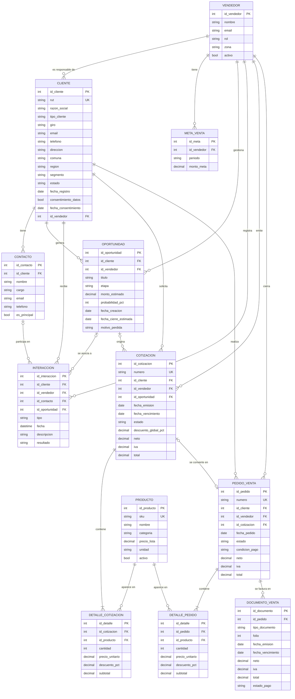

# Data Model: Módulo Ventas / CRM

**Feature**: `002-modulo-ventas-crm` (el `001` corresponde al módulo base del template del curso)
**Estado**: Borrador v0.2 (revisión intermedia, 21 de octubre de 2026). Cambios respecto a v0.1 en la sección 9.
**Alcance**: solo frontend. Los datos se persisten como datos semilla (JSON) y en almacenamiento local del navegador. No hay backend.

---

## 1. Propósito del modelo

El módulo gestiona el ciclo comercial completo de una empresa B2B/B2C:

```
Cliente → Interacción → Oportunidad → Cotización → Pedido de venta → Documento de venta
```

El modelo está pensado para responder tres preguntas de negocio:

1. ¿Qué clientes y oportunidades tiene cada vendedor, y en qué etapa están? (embudo de ventas)
2. ¿Cuánto se vendió, a quién y qué productos? (seguimiento de ventas vs. metas)
3. ¿Qué cotizaciones se convierten en pedidos y cuáles se pierden, y por qué? (tasa de conversión)

---

## 2. Diagrama entidad-relación

GitHub renderiza este diagrama directamente. La versión en imagen está en [`docs/mer.png`](../../docs/mer.png) y se genera desde [`docs/mer.dot`](../../docs/mer.dot).




---

## 3. Diccionario de datos

Convenciones: **PK** = clave primaria, **FK** = clave foránea, **UK** = valor único, **(S)** = dato personal o sensible (ver sección 6).

### 3.1 VENDEDOR
Usuario interno del módulo (equipo comercial).

| Atributo | Tipo | Restricción | Descripción |
|---|---|---|---|
| id_vendedor | int | PK | Identificador interno |
| nombre | string | obligatorio | Nombre completo (S) |
| email | string | obligatorio, único | Correo corporativo |
| rol | enum | `vendedor`, `jefe_ventas`, `admin` | Define permisos en la interfaz |
| zona | string | opcional | Zona o región comercial asignada |
| activo | bool | default `true` | Un vendedor inactivo no puede recibir clientes nuevos |

### 3.2 CLIENTE
Persona natural o empresa que compra o podría comprar.

| Atributo | Tipo | Restricción | Descripción |
|---|---|---|---|
| id_cliente | int | PK | Identificador interno |
| rut | string | UK, formato `12345678-9`, dígito verificador válido | RUT (S) |
| razon_social | string | obligatorio | Nombre o razón social (S si es persona natural) |
| tipo_cliente | enum | `persona`, `empresa` | |
| giro | string | obligatorio si `empresa` | Giro comercial (requerido para facturar) |
| email, telefono | string | opcional | Datos de contacto (S) |
| direccion, comuna, region | string | obligatorio `region` | Ubicación (S si es persona natural) |
| segmento | enum | `pyme`, `gran_empresa`, `persona`, `sector_publico` | Segmentación comercial |
| estado | enum | `prospecto`, `activo`, `inactivo` | Un prospecto pasa a activo con su primer pedido |
| fecha_registro | date | obligatorio | |
| consentimiento_datos | bool | obligatorio | Si autorizó el tratamiento de sus datos para fines comerciales |
| fecha_consentimiento | date | obligatorio si consentimiento = true | Trazabilidad del consentimiento |
| id_vendedor | int | FK → VENDEDOR | Vendedor responsable de la cuenta |

### 3.3 CONTACTO
Persona de contacto dentro de un cliente empresa.

| Atributo | Tipo | Restricción | Descripción |
|---|---|---|---|
| id_contacto | int | PK | |
| id_cliente | int | FK → CLIENTE | |
| nombre, cargo | string | `nombre` obligatorio | (S) |
| email, telefono | string | al menos uno obligatorio | (S) |
| es_principal | bool | máximo uno `true` por cliente | Contacto por defecto |

### 3.4 OPORTUNIDAD
Negocio potencial con un cliente. Es la unidad del embudo de ventas.

| Atributo | Tipo | Restricción | Descripción |
|---|---|---|---|
| id_oportunidad | int | PK | |
| id_cliente | int | FK → CLIENTE | |
| id_vendedor | int | FK → VENDEDOR | |
| titulo | string | obligatorio | Ej.: "Renovación flota de impresoras" |
| etapa | enum | `prospeccion`, `calificacion`, `propuesta`, `negociacion`, `ganada`, `perdida` | |
| monto_estimado | decimal | ≥ 0 | En CLP |
| probabilidad_pct | int | 0 a 100 | Se sugiere por etapa (10, 25, 50, 75, 100, 0) |
| fecha_creacion | date | obligatorio | |
| fecha_cierre_estimada | date | ≥ fecha_creacion | |
| motivo_perdida | enum | obligatorio si etapa = `perdida` | `precio`, `plazo`, `competencia`, `sin_presupuesto`, `otro` |

### 3.5 INTERACCION
Registro de cada contacto comercial (bitácora del cliente).

| Atributo | Tipo | Restricción | Descripción |
|---|---|---|---|
| id_interaccion | int | PK | |
| id_cliente | int | FK → CLIENTE | obligatorio |
| id_vendedor | int | FK → VENDEDOR | obligatorio |
| id_contacto | int | FK → CONTACTO, opcional | Con quién se habló |
| id_oportunidad | int | FK → OPORTUNIDAD, opcional | Si la interacción es parte de un negocio |
| tipo | enum | `llamada`, `correo`, `reunion`, `visita` | |
| fecha | datetime | obligatorio | |
| descripcion | text | máx. 1000 caracteres | Se recomienda no registrar datos sensibles aquí |
| resultado | enum | `positivo`, `neutro`, `negativo`, `sin_respuesta` | |

### 3.6 PRODUCTO
Catálogo de productos o servicios que se venden. **Entidad compartida** con el módulo de Inventario.

| Atributo | Tipo | Restricción | Descripción |
|---|---|---|---|
| id_producto | int | PK | |
| sku | string | UK | Código del producto |
| nombre, categoria | string | obligatorio | |
| precio_lista | decimal | > 0 | Precio neto en CLP |
| unidad | string | obligatorio | `unidad`, `caja`, `hora`, etc. |
| activo | bool | default `true` | Un producto inactivo no se puede cotizar |

### 3.7 COTIZACION y DETALLE_COTIZACION
Propuesta comercial formal al cliente.

| Atributo | Tipo | Restricción | Descripción |
|---|---|---|---|
| id_cotizacion | int | PK | |
| numero | string | UK, ej. `COT-2026-0001` | Correlativo visible |
| id_cliente, id_vendedor | int | FK | obligatorios |
| id_oportunidad | int | FK, opcional | Una cotización puede nacer sin oportunidad previa |
| fecha_emision, fecha_vencimiento | date | vencimiento > emisión | Default: 15 días de validez |
| estado | enum | `borrador`, `enviada`, `aceptada`, `rechazada`, `vencida` | |
| descuento_global_pct | decimal | 0 a 100 | |
| neto, iva, total | decimal | calculados | iva = 19 % del neto; total = neto + iva |

| Atributo (detalle) | Tipo | Restricción | Descripción |
|---|---|---|---|
| id_detalle | int | PK | |
| id_cotizacion | int | FK → COTIZACION | |
| id_producto | int | FK → PRODUCTO | |
| cantidad | int | > 0 | |
| precio_unitario | decimal | > 0 | Se copia desde `precio_lista` al momento de cotizar (histórico) |
| descuento_pct | decimal | 0 a 100 | |
| subtotal | decimal | calculado | cantidad × precio_unitario × (1 − descuento_pct/100) |

### 3.8 PEDIDO_VENTA y DETALLE_PEDIDO
Venta confirmada. Mismos atributos de detalle que la cotización.

| Atributo | Tipo | Restricción | Descripción |
|---|---|---|---|
| id_pedido | int | PK | |
| numero | string | UK, ej. `PV-2026-0001` | |
| id_cliente, id_vendedor | int | FK | obligatorios |
| id_cotizacion | int | FK, opcional, **único** | Una cotización aceptada genera como máximo un pedido. Como no hay backend, la unicidad la valida la aplicación antes de crear el pedido (ver regla 4) |
| fecha_pedido | date | obligatorio | |
| estado | enum | `pendiente`, `confirmado`, `despachado`, `entregado`, `anulado` | |
| condicion_pago | enum | `contado`, `30_dias`, `60_dias` | |
| neto, iva, total | decimal | calculados | |

### 3.9 DOCUMENTO_VENTA
Factura, boleta o nota de crédito asociada a un pedido. **Entidad de interfaz** con el módulo de Contabilidad.

| Atributo | Tipo | Restricción | Descripción |
|---|---|---|---|
| id_documento | int | PK | |
| id_pedido | int | FK → PEDIDO_VENTA | |
| tipo_documento | enum | `factura`, `boleta`, `nota_credito` | Factura requiere cliente con giro |
| folio | int | único por tipo | |
| fecha_emision, fecha_vencimiento | date | | Vencimiento según condición de pago |
| neto, iva, total | decimal | | |
| estado_pago | enum | `pendiente`, `pagado`, `vencido` | |

> En el MVP los documentos son **simulados** (no se conectan al SII).

### 3.10 META_VENTA
Meta mensual por vendedor, para el panel de seguimiento.

| Atributo | Tipo | Restricción | Descripción |
|---|---|---|---|
| id_meta | int | PK | |
| id_vendedor | int | FK → VENDEDOR | |
| periodo | string | formato `AAAA-MM`, único por vendedor | |
| monto_meta | decimal | > 0 | En CLP, neto |

---

## 4. Relaciones y cardinalidades

| Relación | Cardinalidad | Justificación |
|---|---|---|
| VENDEDOR – CLIENTE | 1 : N | Cada cliente tiene un único vendedor responsable de su cuenta |
| CLIENTE – CONTACTO | 1 : N (0..N) | Un cliente persona puede no tener contactos adicionales |
| CLIENTE – OPORTUNIDAD | 1 : N | |
| VENDEDOR – OPORTUNIDAD | 1 : N | El vendedor de la oportunidad puede diferir del responsable de la cuenta (ventas cruzadas) |
| OPORTUNIDAD – COTIZACION | 0..1 : N | Una oportunidad puede tener varias versiones de cotización |
| COTIZACION – DETALLE_COTIZACION | 1 : 1..N | Una cotización sin líneas no es válida |
| PRODUCTO – DETALLE_* | 1 : N | Relación N:M entre producto y cotización/pedido, resuelta por la tabla de detalle |
| COTIZACION – PEDIDO_VENTA | 0..1 : 0..1 | Una cotización aceptada genera un pedido; un pedido puede crearse sin cotización (venta directa) |
| PEDIDO_VENTA – DETALLE_PEDIDO | 1 : 1..N | |
| PEDIDO_VENTA – DOCUMENTO_VENTA | 1 : N | Factura + eventual nota de crédito |
| VENDEDOR – META_VENTA | 1 : N | Una meta por período |
| CLIENTE / VENDEDOR / CONTACTO / OPORTUNIDAD – INTERACCION | 1 : N | Contacto y oportunidad son opcionales |

---

## 5. Reglas de negocio y transiciones de estado

1. **Cálculo de montos**: neto = ∑ subtotales × (1 − descuento_global_pct/100); iva = 0,19 × neto; total = neto + iva. Montos en CLP sin decimales (redondeo al entero).
2. **Precio histórico**: `precio_unitario` se copia al crear la línea. Cambiar `precio_lista` no altera cotizaciones ni pedidos existentes.
3. **Oportunidad**: `prospeccion → calificacion → propuesta → negociacion → ganada | perdida`. Al pasar a `perdida` se exige `motivo_perdida`.
4. **Cotización**: `borrador → enviada → aceptada | rechazada | vencida`. Pasa automáticamente a `vencida` si la fecha actual supera `fecha_vencimiento` estando `enviada`. Solo una cotización `aceptada` puede convertirse en pedido, y solo una vez: antes de crear el pedido la aplicación verifica que no exista otro `PEDIDO_VENTA` con el mismo `id_cotizacion`. Al convertirse, su oportunidad (si tiene) pasa a `ganada`.
5. **Pedido**: `pendiente → confirmado → despachado → entregado`; `anulado` es posible solo antes de `despachado`.
6. **Cliente**: un `prospecto` pasa a `activo` al confirmarse su primer pedido.
7. **Documento**: no se emite `factura` si el cliente no tiene `giro`; en ese caso corresponde `boleta`.

---

## 6. Datos sensibles y riesgos (resumen preliminar)

| Dato | Riesgo | Medida en el MVP |
|---|---|---|
| RUT, nombre, email, teléfono, dirección de personas naturales | Datos personales | Enmascarar RUT en listados (`12.***.***-9`); visible completo solo para rol `jefe_ventas`/`admin` |
| Consentimiento | Uso comercial sin autorización | Si `consentimiento_datos = false`, el formulario de interacción muestra una advertencia y bloquea registrar contactos salientes de tipo `llamada` o `correo` (decisión preliminar; validar en `spec.md`) |
| Texto libre en `INTERACCION.descripcion` | Registro de información sensible no estructurada | Aviso en el formulario; límite de caracteres |
| Datos semilla | Exposición de personas reales | Todos los datos del MVP son **ficticios** |

**Sesgos asociados al uso de los datos** (a desarrollar en `spec.md`):
- **Sesgo de registro**: las métricas por vendedor dependen de cuánto registra cada uno. Un vendedor que anota menos interacciones parece menos activo aunque no lo sea.
- **Sesgo de supervivencia en el embudo**: si solo se registran las oportunidades que avanzan, la tasa de conversión queda sobreestimada. Por eso `motivo_perdida` es obligatorio.
- **Sesgo de segmentación**: priorizar clientes por monto histórico tiende a postergar a pymes y clientes nuevos.

Marco normativo de referencia: Ley 19.628 sobre protección de la vida privada y la Ley 21.719, que la modifica. La Ley 21.719 entra en vigor el 1 de diciembre de 2026; el 1 de septiembre de 2026 el Gobierno ingresó al Senado un proyecto que propone postergarla hasta el 1 de diciembre de 2027 (en tramitación a octubre de 2026).

---

## 7. Integración con otros módulos del ERP

| Entidad | Módulo relacionado | Tipo de vínculo |
|---|---|---|
| PRODUCTO | Inventario / Distribución (SCM) | Catálogo compartido; Ventas solo lo lee |
| PEDIDO_VENTA | Distribución (SCM) | Un pedido `confirmado` dispara el despacho |
| DOCUMENTO_VENTA | Contabilidad | Cuentas por cobrar y libro de ventas |
| VENDEDOR | Recursos Humanos | El vendedor es un trabajador; su ficha maestra pertenece a RR.HH. |

Los identificadores de estas entidades deben coincidir con los que use el template del curso para permitir la interconexión entre módulos.

---

## 8. Indicadores que habilita el modelo

| Indicador | Cálculo |
|---|---|
| Ventas del período | ∑ neto de PEDIDO_VENTA con estado ≠ `anulado` (sin IVA, misma base que `META_VENTA.monto_meta`) |
| Cumplimiento de meta | ventas netas del vendedor / monto_meta |
| Tasa de conversión de cotizaciones | cotizaciones `aceptada` / cotizaciones emitidas |
| Valor ponderado del embudo | ∑ (monto_estimado × probabilidad_pct/100) de oportunidades abiertas |
| Ticket promedio | ventas del período / número de pedidos |
| Motivos de pérdida | frecuencia de `motivo_perdida` |
| Días promedio de cierre | promedio de (fecha del pedido − fecha_creacion de la oportunidad), solo para pedidos que vienen de una cotización con oportunidad asociada |

---

## 9. Registro de cambios

| Versión | Fecha | Cambio |
|---|---|---|
| v0.1 | 20-10-2026 | Versión inicial para la revisión intermedia |
| v0.2 | 21-10-2026 | `docs/mer.png` regenerado: con `splines=ortho` Graphviz dibujaba invertida la pata de gallo en 9 de 20 relaciones (ej. CLIENTE–CONTACTO). Se usa `splines=polyline` y se verificó cada relación |
| v0.2 | 21-10-2026 | Regla 4: se explicita que la unicidad de `PEDIDO_VENTA.id_cotizacion` la valida la aplicación (no hay backend) y que la oportunidad pasa a `ganada` solo si existe |
| v0.2 | 21-10-2026 | Sección 6: la regla de consentimiento hablaba de "interacciones de marketing", tipo que no existe en `INTERACCION.tipo`; se reformuló con los tipos reales |
| v0.2 | 21-10-2026 | Sección 8: "Ventas del período" pasa a calcularse sobre el neto, para compararse con la meta (que es neta). "Días promedio de cierre" se limita a pedidos con oportunidad |
| v0.2 | 21-10-2026 | Se actualizó la situación de la Ley 21.719 (vigencia y proyecto de postergación) |
| v0.2 | 21-10-2026 | La carpeta pasa de `specs/001-modulo-ventas-crm/` a `specs/002-modulo-ventas-crm/`: el template ya usa `001-erp-base-module` y Speckit numera las features nuevas a partir del número más alto |
